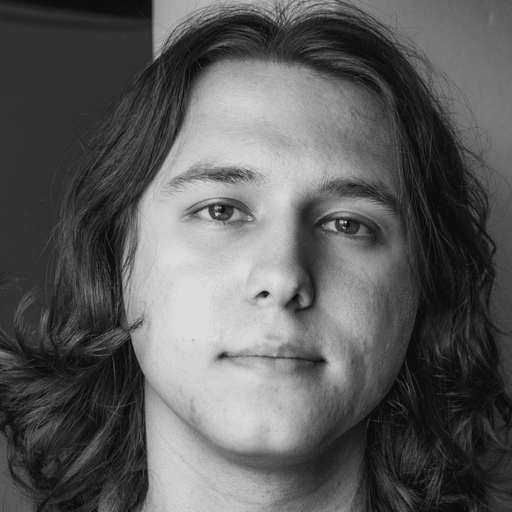

  

# Who am I?
I'm an engineer. I don't like staying in just one layer of it, though. I love building things, learning how things work, because to me engineering is a form of art.

I studied electrical and electronics engineering. Right now I build instruments used in labs around the world.