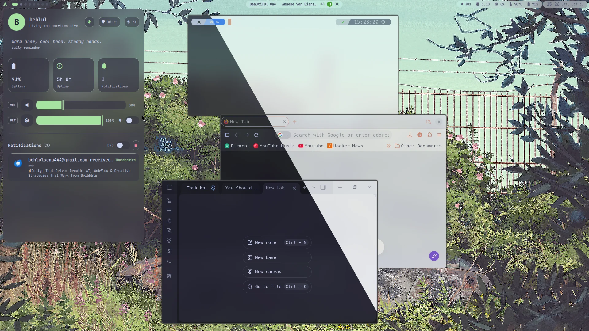
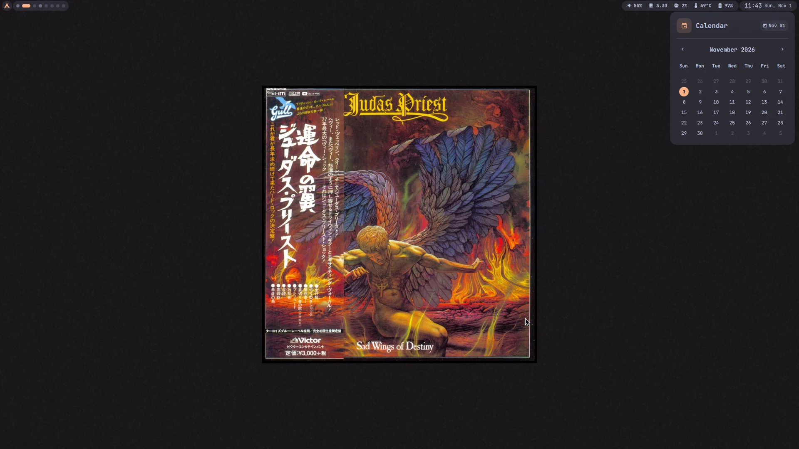
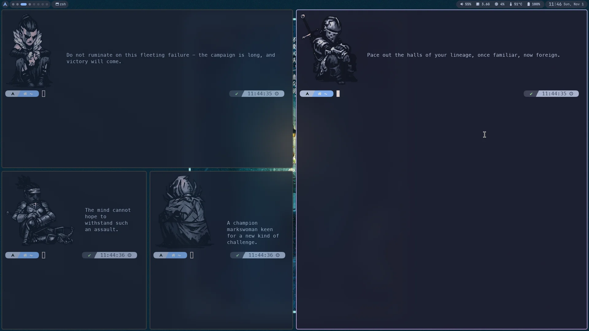

# TL;DR
Learn what your computer is doing, what does it look like while doing that. Then customize it, tailor it for your need.  
# Little Programs Doing Their Jobs... 
When a person turns on a computer, most of them don't think about what is going on at the background. Everything is ready for users to perform their usual tasks like clicking application bar to open an application, using mixer to change volume of the sound, checking notifications panel to see if anything important is happening on the system or just using a button to turn off your system. 

These all seem like everything working as a one immutable block of system. But in reality there is no such a thing. Every little operation has its own component and every one of them performs its job to provide user with a seamless experience on their computers. 

In Linux, when you spin up your favorite resource monitor, like top, htop or btop, you can see all the processes that are running and you can research about that program to learn what it is doing. And since you are a free person that is using a Linux distribution, you can probably change that program with something else, even write it yourself. This software could be providing you with a user interface for seeing your application bar or it could be a background process that manages your network configuration. 

# Personalize Your System
Ricing means customizing your machine according to your needs and your liking. 
When I first started ricing, I get really confused. What kind of Linux distribution is the best? What components I need to install on my system to use my computer effectively? There are so many software that is written to get a job one, which one to choose? How to configure those?

It all comes to what you want, you can get inspirations from other people by looking at how they use their system, how you can adapt it for yourself. There is a whole [subreddit](https://www.reddit.com/r/unixporn/) dedicated to customize Unix systems, very inspiring. Lots of anime girls... but still inspiring :)

So for example my priorities was like this:
1. It should be a keyboard focused system
2. There must be dark/light mode option system wide
3. I should be able to easily add new features like buttons, status etc.
4. Since I am an engineer I use my computer A LOT. I want to look something beautiful.
In the end I built something like this below:

I use a dynamic tiling window manager instead of a DE, because I aimed for a keyboard focused system. I can switch between dark/light modes by using a button on the top bar or a shortcut that I bind. Most used applications changes theme immediately by running a simple custom script at the background. Some programs need some line changes in their configuration, some changes their theme by executing a command. There is no magic solution that works instantly... or is it? Basically you are able to create your own magic! 

# Craft Your Experience

My brother created the [chillbg](https://github.com/Fansesi/chillbg) project for me to create custom wallpapers. This project gets posters or images and puts them in the center with a frame around it. Then it generates a background with a color of your choice and adds noise like Gaussian, Poisson etc. 

I really like the Darkest Dungeon game as I am a big fan of the Lovecraftian horror genre. So I made script that shows a Darkest Dungeon character when the terminal is first opened. I used [viu](https://github.com/atanunq/viu) for displaying images. Then we added some quotes from the game next to the characters and [tiq](https://github.com/Fansesi/tiq) project is born.

Also from the productivity perspective:
1. System looks clean, no distraction (I don't use tiq all the time xd)
2. I can use keyboard to navigate quickly since I am using a tiling window manager
3. The information I need is available at first glance: ram/cpu usage, cpu temp, what I am listening right now
4. I can launch any app I want in a split second instead of click on a start menu, wait for thousand ads to load, search for the application but get results from the internet, unrelated folders and files, then maybe if you can find it finally click the application...

So the system is fast and require few steps to do common tasks. 
# You Should Rice Your System
Ricing is great. For me, ricing is about both functionality and looking good at the same time. It is like decorating your room, where you try to place your things in a way that is comfortable and functional but also beautiful. The idea of having something special that is made by yourself, for yourself, is really fulfilling.

So:
- You understand that creating beautiful UI and comfortable UX is not easy
- You create lots of scripts using bash and python
- You read lots of different documentation
- You get to have a unique system, massive flex if you ask me
- You learn a lot about Linux user-space internals

# Typical Components
Lastly, I wanted to give the reader some of the components that assembles a system with their Arch Wiki links for further reading:

- **[Bootloader](https://wiki.archlinux.org/title/Arch_boot_process#Boot_loader) (e.g., GRUB):** this is the program that starts when the computer boots and loads the Linux kernel.
- **[Init system](https://wiki.archlinux.org/title/Init) (systemd):** this starts and manages all the services and processes after the system boots.
- **[Display server](https://en.wikipedia.org/wiki/Windowing_system#Display_server) (e.g., X.Org Server or Wayland):** this controls how graphical programs draw things on the screen.
- **[Display manager](https://wiki.archlinux.org/title/Display_manager) (e.g., LightDM):** this is the graphical login screen where you enter your username and password. I remember the name confused me at first.
- **[Window manager](https://wiki.archlinux.org/title/Window_manager) (e.g., Hyprland):** this controls how windows open, move, resize, and tile on the screen.
- **[Desktop environment](https://wiki.archlinux.org/title/Desktop_environment) (e.g., GNOME or KDE Plasma):** this provides the FULL graphical interface including panels, settings, and apps. 
- **Terminal emulator (e.g., Wezterm):** this is the program that opens a command-line window.
- **[Shell](https://wiki.archlinux.org/title/Command-line_shell) (e.g., Bash or Zsh):** this is the command interpreter that runs commands in the terminal.
- **[Package manager](https://en.wikipedia.org/wiki/Package_manager) (e.g., pacman or apt):** this installs, updates, and removes software from the system.
- **Application launcher (e.g., Rofi, KRunner or Vicinae):** this lets you quickly search and start programs.
- **File manager (e.g., Thunar, Dolphin):** this lets you browse, copy, move, and delete files with a GUI.
- **Text editor (e.g., Nano, Neovim):** this is used to edit files and code.
- **[Network configuration](https://wiki.archlinux.org/title/Network_configuration) (e.g., NetworkManager):** this manages Wi-Fi, Ethernet, DNS, how you connect to internet, and other network connections. Could be one or multiple tools.

and the list goes on according to your needs...
